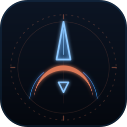

<p align="center">
  
</p>

<h1 align="center">Fleet Manager</h1>

<p align="center">
  <em>Your agents, on a board, not behind a wall of text.</em><br>
  A desktop command room for a fleet of coding agents.
</p>

<p align="center">
  <a href="https://tonyheadband.github.io/fleet-manager/"></a>
  
  
  <a href="LICENSE"></a>
</p>


- **Fly by hand.** Answer, pause and review each agent from its card, with its live terminal and diff one click
  away.
- **Autopilot.** An orchestrator agrees the goal with you, breaks it down and runs specialists under a policy you
  set.
- **Specialists.** Narrow agents with one job each, whose limits fleet-manager enforces, not only their prompt.

With a few agents running in their own terminals, you cannot see who is working, who is stuck and who is waiting
on you. Here every agent, subagents included, is a card whose status comes live from Claude Code hooks, so you
answer the card that needs you. More in [what fleet management means here](https://tonyheadband.github.io/fleet-manager/concept/).

Today you fly by hand, and orchestrated tasks run with you approving each step. Autopilot and enforced limits are
next: see [ROADMAP.md](ROADMAP.md).

## Quick start

Requirements: Linux (glibc 2.28+), tmux 3.2+, Claude Code, GitHub CLI 2.40+, git; building needs Rust with
`cargo-zigbuild` and a zig.

```bash
./build.sh
dist/packaging/install.sh
fleet-gui
```

The setup wizard walks you through your first persona. Full steps: [Install](https://tonyheadband.github.io/fleet-manager/getting-started/install/).

## Documentation

| Section | What it covers |
|---|---|
| [**Getting started**](https://tonyheadband.github.io/fleet-manager/getting-started/install/) | Install, then your first persona and task. |
| [**Guide**](https://tonyheadband.github.io/fleet-manager/guide/board/) | The board, products and releases, tasks, orchestrated tasks, personas, management. |
| [**Reference**](https://tonyheadband.github.io/fleet-manager/reference/configuration/) | Configuration and architecture. |
| [**Contributing**](https://tonyheadband.github.io/fleet-manager/contributing/development/) | Tests, UI internals, demo media. |

## License

[Apache-2.0](LICENSE)
