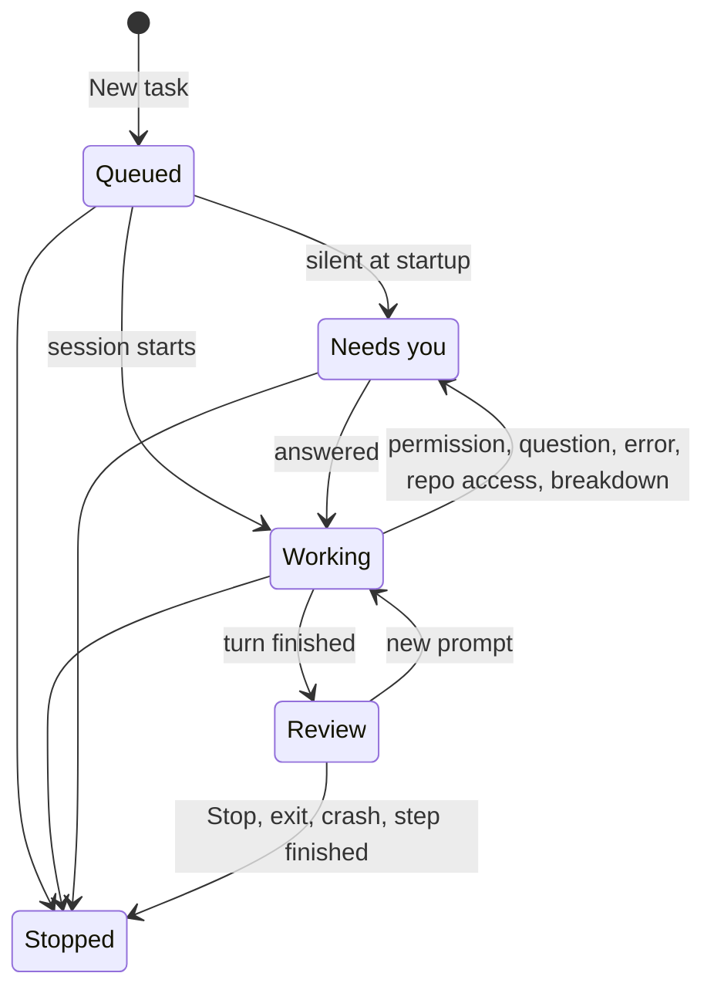

# The board

The board (the Kanban view) shows every agent of the active product as a card. It is driven by Claude Code hooks,
not by scraping the terminal: each agent's hooks post to the daemon, and the card moves when they do.


## Columns

| Column | What the agent is doing |
|---|---|
| Stopped | Not running any more. The card says why: stopped by you, exited, crashed, or finished its step. |
| Queued | Started, and Claude Code has not reported in yet. |
| Working | Thinking or running a tool. |
| Needs you | Waiting on you. |
| Review | Finished its turn; read what it did. |

How a card moves between them:



## Why a card needs you

A card in Needs you says why:

- **Permission needed**: Claude Code asks before running a tool.
- **Question**: the agent asks you something.
- **Error**: the turn stopped with an error.
- **Startup prompt**: no hook arrived within the startup grace period, which usually means Claude's "trust this
  folder" dialog is up.
- **Repo access**: the agent asked for another repo; grant or refuse it from the card.
- **Breakdown to review**: an orchestrator proposed steps; see [Orchestrated tasks](orchestrated-tasks.md).

## Act from the card

Answer, pause, resume, stop. Answer is offered on Needs you (except a repo-access request, which is granted or
refused); Pause on Working and Review; Stop on any card that is still running.

The side panel shows the agent's live terminal (read-only) and the diff of every repo in the task, plus the
breakdown for an orchestrated task. **Open in terminal** in the panel takes over the agent's terminal in a window
of its own; see below.

The board can be filtered by repo, by persona and by release.

A Working card's edge sweeps and a Needs you card's edge pulses while the window has focus; Settings → General →
Motion turns that off.

## Agents outlive the app

Each agent runs as the interactive `claude` CLI in a terminal session the daemon owns. Close the window and choose
**Keep the daemon running**: the agents keep working, and the board is where you left it when you come back. If you
stop the daemon instead, running agents stop and are resumed (`claude --resume`) the next time it starts.

To type into an agent's terminal yourself, click **Open in terminal** in its side panel, or run `fleet-attach`
from the app folder:

```bash
fleet-attach <agent id>      # Ctrl-] detaches; the agent keeps running
```

Open in terminal is offered only while the agent runs and the daemon is on this machine.
