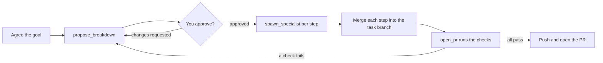

# Orchestrated tasks

An orchestrated task is run by an orchestrator agent instead of one agent you fly by hand. The orchestrator
agrees the goal with you, proposes a breakdown you approve in the side panel, launches specialist agents, merges
their branches and opens one PR after the repo's tests pass. The board shows the task as one group with a
rolled-up status.

## Types

Pick a Type when you create a task, instead of Solo. The built-in types are `direct` (one step) and `structured`
(brainstorm, plan, one specialist per task, a review step).

## Flow



1. New task: pick the Type, the persona and one repo. The orchestrator may use every specialist that loads, less
   the ones the product hides (see [Specialists](#specialists)).
2. You talk to the orchestrator in its terminal until the goal is agreed.
3. It proposes a breakdown; the task goes to Needs you. Approve it or request changes in the side panel.
4. It launches one specialist per step. Each is a normal agent on the board with its own worktree, on a sub-branch
   of the task branch; the orchestrator merges each finished step back.
5. When the steps are done it calls `open_pr`: the daemon runs the checks the repo's workflow file lists for the
   change, and only if they pass pushes the task branch and opens the PR. It first checks the
   [pull request rules](#pull-request-rules) and pushes nothing when one is missed. The default stop is an open PR; nothing
   is merged.

Every question and permission prompt still reaches you; there is no autopilot yet. Orchestrators and specialists
cannot spawn in-chat subagents, and an orchestrated task has exactly one repo.

## Specialists

An orchestrator is shown every specialist that loads, built-in or yours, with its summary, and picks one per step.
A new specialist you add in Management is offered to the next orchestrated task with nothing else to set.

To keep one away from a product, tick it under **Hidden specialists** in Management → Products → the product and
**Save hidden specialists**. A hidden specialist is left out of the orchestrator's `CLAUDE.md`, and a breakdown step
that names it is refused: `step <n>: <name> is not one of this task's specialists`. A task keeps the specialists it
started with: hiding or unhiding one changes only the tasks started after. With every specialist hidden, a new
orchestrated task is refused: `every specialist is hidden or does not load: unhide one in Management → Products`.

The daemon serves the list as `hidden_specialists` on each product, and replaces it with
`PUT /api/products/{id}/hidden-specialists` (`{"hidden": ["<name>", …]}`); a name that is not a specialist that loads
is refused with 400.

## Mode and effort

Every agent starts with an explicit permission mode and effort, so a `structured` orchestrator planning a feature
and a `docs` specialist fixing a typo no longer both take whatever your Claude settings default to. The daemon passes
`--permission-mode` and `--effort` on every start, and the side panel shows both next to the model.

**Modes.** Whoever decides on a tool the agent is not already allowed to use:

| Mode | Decides |
| --- | --- |
| `auto` | A classifier: routine work goes through, risky actions (external writes, destructive ones, credentials) are blocked |
| `acceptEdits` | Edits in the working folders go through; you approve everything else |
| `manual` | You, every time |
| `dontAsk` | Nobody: the allow list runs and everything else is refused on the spot |

**Efforts** are `low`, `medium`, `high`, `xhigh` and `max`.

`plan` and `bypassPermissions` are refused wherever a mode can be set (config, a definition, a product override),
with a message naming the allowed modes, for example `mode plan is not allowed (auto, acceptEdits, manual, dontAsk)`.
A definition file with one is listed with that error in Management and does not stop the others from loading.

### Layers

The values are resolved when an agent starts. The nearest layer that sets one wins:

| Layer | Mode | Effort |
| --- | --- | --- |
| Global default: `config.toml` or Settings → General | `default_mode`, default `auto` | `default_effort`, default `medium` |
| Definition front matter | `mode:` | `effort:` |
| Product override: Management → Products → Overrides | section `modes`, key = definition name | section `efforts`, key = definition name |
| Step in the breakdown, specialists only | Stricter only; locked by `dontAsk` | Any level |

An orchestrator resolves through the first three layers: its type is the definition. A solo agent has no definition
and takes the global defaults. The built-in definitions all set `mode:` and `effort:`, so `default_mode` and
`default_effort` do not reach them; to make orchestrated agents ask, set the product override
`modes.<definition name> = "manual"`. A user definition without `mode:` or `effort:` takes the global defaults, not the
built-in's values. The built-in values are:

| Definition | Mode | Effort |
| --- | --- | --- |
| `structured`, `direct`, `reviewer` | `auto` | `high` |
| `rust`, `typescript-react`, `test-writer` | `auto` | `medium` |
| `docs` | `auto` | `low` |

The orchestrator's `CLAUDE.md` lists each specialist as `- <name> (<mode>, <effort> effort): <summary>`, with the
values the specialist would start with before any step changes them.

A running agent keeps its values. Resuming an agent reuses the ones it started with, or resolves them when it was
stored before this feature. Restarting an orchestrator resolves them again from the layers as they are then.

### A step can only make the mode stricter

An orchestrator may add `mode` and `effort` to a step in `propose_breakdown`. Effort is free. The mode is ordered
`auto` < `acceptEdits` < `manual`: a step may name the mode its specialist resolves to without the step, or a
stricter one, never a looser one. The step offers only those three modes. The owner's layers stay the ceiling: an
orchestrator cannot give a specialist more permission than the definition and the product allow, whatever the
breakdown says.

`dontAsk` is a lock, not a level, because it is a fixed allow list. When a specialist resolves to `dontAsk`, a step
may not name any mode. When it resolves to anything else, a step may not name `dontAsk`. Only a definition file or a
product override changes a `dontAsk` role. For example, `reviewer` is `auto` as shipped; to lock it, set
`modes.reviewer = dontAsk` on the product together with allow rules that cover its work (read files, run the repo's
tests).

`propose_breakdown` refuses a step before it stores the version, and the orchestrator fixes the step and proposes
again. These refusals do not count against your approval:

| Step | Refusal |
| --- | --- |
| Mode looser than the specialist's | `step 2: mode auto is looser than rust's manual (a step can only make it stricter)` |
| Any mode on a `dontAsk` specialist | `step 3: reviewer runs in dontAsk, which a step cannot change` |
| `dontAsk` on a step | `step 4: dontAsk is set on a definition or a product, not on a step` |

A step that has started keeps its mode and effort: changing either in a later version is refused with
`step <n> has started, so its mode cannot change` (or `effort`). A breakdown stored before this feature has no step
values and resolves as if each step named none.

The check runs again at `spawn_specialist`, against the overrides as they are then. If you tightened a product
override after approving a breakdown, a step that is now looser than its specialist is refused with the same message
and nothing starts; the orchestrator proposes the step again.

## The workflow file

A repo needs a **`.fleet/workflow.yml`** on its base branch on `origin` before an orchestrated task can use it: it
lists the checks the gate runs before a pull request, and is fetched when the task is created.

### Shared build output

A repo can give every agent of a task the same environment variables with an optional `env:` section. Its main use is
one build folder per task instead of one per agent:

```yaml
env:
  CARGO_TARGET_DIR: "{task}/target"
steps:
  ...
```

Without it, each specialist's worktree builds into its own `target/`. Measured on this repo, that is 12 to 26 GB per
specialist, and a task with several specialists fills a disk. With the example above they all build into one folder
and only recompile what changed. Parallel specialists then wait on cargo's build lock for each other, which costs
time instead of disk.

- **Values.** `env` maps a variable name to a string. A value is passed as written, except that one starting with
  `{task}/` has that part replaced by the task's folder, so `{task}/target` becomes `<task folder>/target`. `{task}`
  is the only placeholder, and only as that prefix.
- **Refused.** A bare `{task}`, `{task}/` with nothing after it, any other `{name}`, a `\` in the path, and a path
  with an empty, `.` or `..` component are invalid. So is a path that starts with a folder Fleet Manager keeps in the
  task folder, in any case: `orchestrator`, `fleet`, `internal`, `internal-snapshots`, `BREAKDOWN.md` or
  `gate-build`. The first folder may not end with `.` or a space, which Windows drops.
- **Names.** A name is letters, digits and `_`, not starting with a digit. These are refused: `CLAUDE_CONFIG_DIR`,
  `FLEET_TOKEN`, `GH_*`, `GIT_*`, the MCP timeout variables Fleet Manager sets, the login variables it keeps from
  agents (such as `ANTHROPIC_API_KEY`, `GITHUB_TOKEN` and `SSH_AUTH_SOCK`), and, for a repo only, `PATH`, `HOME`,
  `XDG_CONFIG_HOME`, `BASH_ENV`, `ENV`, `LD_PRELOAD`, `LD_LIBRARY_PATH`, `LD_AUDIT` and `DYLD_*`. A repo's names are
  matched ignoring case, so `Path` is refused like `PATH`. Variables such as `RUSTC_WRAPPER` or `RUSTFLAGS` are
  allowed.
- **One bad entry** makes the whole `workflow.yml` invalid, so nothing applies halfway.
- **When it is read.** From `origin/<base>`, once, when the orchestrator starts, and kept with the task. A change to
  `env` on the base branch does not reach a task that is already running.
- **Agents** of the task, orchestrator and specialists, get the expanded variables. They win over the same variable
  in Management → Agent settings → Environment.
- **The gate** gets them too, so its steps build where the agents did. The fleet-wide environment never reaches the
  gate: its result has to match CI.
- **`pr_gate_build`** (a global setting and a product override, see
  [Configuration](../reference/configuration.md)) picks how the gate uses `{task}`. With `shared`, the default, it
  builds in the same folder as the agents. With `clean`, `{task}` becomes `<task folder>/gate-build/` for that run, so
  `{task}/target` is `<task folder>/gate-build/target`. The folder is emptied before the run and removed after, pass
  or fail.
- **Archive** removes the build paths a `{task}/…` value names, and a `gate-build/` left by a killed daemon. It never
  removes a path reached through a link, or one at, in or around a worktree or repo of the task: that path stays,
  and the daemon log names it. A value without `{task}` is never removed. The archive plan and the
  footprint list them as **build output**.

Fleet Manager does not create the folder: the build tool does. Stopping a task keeps it. A repo's `env` is shown
variable by variable in Management → Products: see
[Environment](management.md#agent-settings-environment).

A daemon that predates this section reads a `workflow.yml` with `env:` as invalid, so add it only once everyone's
daemon is new enough. Solo tasks never use it.

## Internal resources

Each product has a private notes repo. Designs, plans and decisions go there instead of into the code repo. It is
either local-only or your own remote repo.

- **Local-only** (the default): a git repo the app owns at `<state_dir>/internal/<product-id>`, with no remote.
  Nothing pushes it. It is made with the product, or on the first orchestrated task of an older product.
- **Your own repo:** set an HTTPS **Internal repo URL** on the product (Management → Products). The daemon clones it
  to the same folder, `<state_dir>/internal/<product-id>`, using the product's default persona's GitHub login, so the
  URL must be on that persona's host and the product needs a default persona. The clone is the app's own: it is never
  your checkout, and nothing you have checked out is touched. Tasks start from the remote's `main`, and each task's
  notes are merged into `main` and pushed. An existing local-only repo is moved aside, not merged, to
  `<product-id>.local-<YYYYMMDD-HHMMSS>` next to it.

Either way a new repo has the same layout: a `README.md` and, in `specs/`, `plans/`, `tasks/`, `docs/` and
`scripts/`, a `README.md` saying what goes there. An empty remote is given the layout and it is pushed; a remote
that has branches but no `main` is refused.

- **Orchestrator:** gets a read-write worktree at `<task workdir>/internal`, on the branch `task/<task-name>`. Its
  `CLAUDE.md` has an "Internal resources" section naming the path and the task's folder in it, `tasks/<task-name>/`.
  The `structured` orchestrator writes `tasks/<task-name>/design.md` and `tasks/<task-name>/plan.md` there and
  commits them with `git -C <path> add -A && git -C <path> commit -m "<message>"`. Solo tasks get no internal
  worktree.
- **Specialists:** get a read-only, detached snapshot at `<task workdir>/internal-snapshots/<n>-<slug>`, as of the
  orchestrator's last commit when the specialist was spawned. Their briefs name the design and plan by their paths
  relative to the notes folder, such as `tasks/<task-name>/plan.md`. `spawn_specialist` is refused while the
  orchestrator's internal worktree has uncommitted changes: `commit your internal resources first: git -C <path>
  add -A && git -C <path> commit -m "<message>"`.
- **Merging:** each successful `open_pr` merges `task/<task-name>` into the product's `main` notes. On a product
  with its own repo the daemon first brings `main` up to the remote's, then pushes it, trying again up to three times
  when the remote moved meanwhile. The PR is already open, so a failed merge or push never stops it. The task log
  says what happened:

    | Log line | What happened | What to do |
    | --- | --- | --- |
    | `internal notes merged and pushed` | Merged and pushed to your repo. | Nothing. |
    | `internal notes merged into the product's notes` | Merged, on a product with no remote to push to. | Nothing. |
    | `internal notes merged, not pushed: <message>; the next merge or a daemon restart retries` | Merged locally; the push failed, for example the remote was unreachable or the default persona's GitHub login failed. | Nothing, or fix the cause named in the message. |
    | `internal notes not merged: conflict in <paths>; task/<task-name> is pushed to resolve by hand` | The task's notes conflict with `main`. The merge was aborted and the branch pushed. | Merge `task/<task-name>` into `main` from your own checkout of the repo, resolve, and push. |
    | `internal notes not merged: <git's message>; task/<task-name> is pushed to resolve by hand` | The merge stopped for another reason; same as above. | Same. |
    | `internal notes not merged: conflict in <paths>; the next pull request retries` | The same conflict on a product without a remote, or with the remote unreachable: nothing was pushed. | Nothing. The branch stays and the next PR merges it again. |
    | `internal notes not merged: <git's message>; the next pull request retries` | The same, for a stop that is not a conflict. | Same. |

    Any line can end with `; earlier unpushed notes conflicted with the remote and are on fleet/unpushed-<stamp> to
    merge by hand`. Notes merged earlier but never pushed conflicted with new commits on the remote. The daemon
    pushed them to that branch and restarted its `main` from the remote's. Merge `fleet/unpushed-<stamp>` into
    `main` from your own checkout, resolve, and push.

    A task that starts while the remote cannot be fetched logs `internal notes: cannot fetch the remote (<message>);
    starting from the local copy`, or `internal notes: cannot reach the remote (<message>); starting from the local
    copy` when the default persona's GitHub login fails. Its branch is cut from the app's last copy of `main`, and the
    merge reconciles it later. When the daemon starts it also pushes any notes an earlier push left behind, in the
    background. A conflict found then is logged by the daemon, not on a task, and shows in Internal resources as
    below.
- **Archive:** removes the worktrees and keeps the `task/<task-name>` branch.

The read-only access is not a security boundary, like the push block below. A specialist gets an
`Edit(//<path>/**)` deny rule, which covers the built-in file-editing tools, plus the snapshot as an additional
directory. It runs as the same OS user, so a shell command can still write there.

Read them in Management → Products → a product → **Internal resources**: a branch picker, the files and, for a
file, its text and last commit. It is read-only. Above them it says `Remote: <url>` (credentials removed) or
`Local only`, how many commits are `not pushed`, `Unpushed notes parked on fleet/unpushed-<stamp>; merge it by hand`
for each parked branch still on the remote and, after a failed push, the error. The daemon serves the same data over
HTTP:

| Route | Returns |
| --- | --- |
| `GET /api/products/{id}/internal/branches` | The branches |
| `GET /api/products/{id}/internal/files?branch=` | The files on a branch |
| `GET /api/products/{id}/internal/file?branch=&path=` | One text file |
| `GET /api/products/{id}/internal/history?branch=&path=&limit=` | Commits, newest first |

`branch` defaults to `main`; `limit` defaults to 50 and is at most 200. Files are text up to 1 MiB. A `..`
component, an absolute path or a symlink is refused with 400; an unknown product, branch or path is 404.

## Pull request rules

A pull request an orchestrator opens follows a **PR style**: a title pattern, the sections the body needs, whether
it carries a version note, and prose telling the orchestrator how to write each. The orchestrator gets the rules in
its `CLAUDE.md` under "Pull requests", so it plans for them from the start, and `open_pr` checks them.

### Styles

A style is a definition, like an orchestrator or a specialist. These are built in:

| Style | Title | Sections | Version note |
| --- | --- | --- | --- |
| `conventional-semver-pre1.0` | Conventional Commits: `feat(scope): …` | Summary, Test plan | Before 1.0: breaking is `minor`, feature and fix are `patch` |
| `conventional-semver` | Conventional Commits | Summary, Test plan | Usual semver: breaking is `major`, feature is `minor`, fix is `patch` |
| `conventional` | Conventional Commits | Summary, Test plan | None |
| `minimal` | Any | Summary | None |
| `plain` | Any | None: its guidance is advice and nothing is checked | None |

Add your own as `pr-styles/<name>.md` in `fleet/` in the config folder, or edit a built-in in Management → **PR
styles**; a user file with a built-in's name overrides it. The front matter has `name`, `summary`, and the optional
`title` (a regex), `sections` (headings) and `versioning` (`semver`, `semver-pre1.0` or `none`, the default). The
text after it is guidance for the orchestrator. A bad regex, an unknown `versioning` or a missing `summary` is shown
as a load error, like any other definition.

### Which style applies

1. `pr.style` in the repo's `.fleet/workflow.yml`, if set. The repo then behaves the same under any product.
2. Else the product's `pr.style` override (see [Overrides](management.md#overrides)).
3. Else `pr_style` in `config.toml`, set in Settings → General under **Pull requests**. It defaults to `plain`, which checks nothing, so a new install never refuses a PR for rules.

The rules are resolved once, when the task starts, and stored on the task. Editing a style or the settings changes
only later tasks, and the rules survive a daemon restart. Solo tasks and tasks started before this feature have no
rules, and `open_pr` checks nothing for them.

If the style a repo pins or a product picks is missing or does not load, the task is refused rather than started
under another style: ``PR style `<name>` (set in <from>) does not load: <error>``.

### Repo facts

The `pr:` section of `.fleet/workflow.yml` is optional, and so is each key:

```yaml
pr:
  style: conventional-semver-pre1.0
  release_notes: packaging/changes/unreleased.md
  breaking: [crates/fleet-daemon/migrations/**]
steps:
  ...
```

| Key | What it does |
| --- | --- |
| `style` | Pins the PR style for this repo |
| `release_notes` | The file a release-notes line goes in. Without it there is no release-notes rule |
| `breaking` | Globs for files whose change is breaking. Without it there is no version-note check |

Unknown keys under `pr:` are refused, as elsewhere in the file. A daemon that predates the section reads a
`workflow.yml` with `pr:` as invalid, so add it only once everyone's daemon is new enough.

### What `open_pr` checks

`open_pr` checks the rules before any workflow step, and pushes nothing when one is missed. It checks:

- **Title**: matches the style's pattern, on one line.
- **Sections**: each section is a heading in the body, of any level and in any case.
- **Version note**: when the change touches a `breaking` path under a semver style, a line
  `Version: <major|minor|patch> — <why>` (a plain `-` also works). Only that the line is there is checked, not which
  word.
- **Attribution**: the body ends with the attribution line, when `pr_attribution` is not empty.
- **Release note**: when the breakdown planned one, the `release_notes` file is in the diff.

A refusal lists every miss and is stored as a `pr` step in the task's gate runs, so it shows in the breakdown's gate
panel. The messages are:

| Miss | Message |
| --- | --- |
| Title | ``title does not match `<pattern>` `` |
| Section | ``no `## <section>` section`` |
| Version note | ``breaking path <paths> changed: add `Version: <word> — <why>` `` |
| Attribution | `the body does not end with the attribution line` |
| Release note | `step <n> planned a release note but <file> is unchanged` |

A miss in the title, sections, version note or attribution is the orchestrator's to fix: it calls `open_pr` again
with a new title or body. A refusal with at least one of those misses counts toward `max_pr_attempts` (see
[Limits](#limits)), also when a release note is missing too.

A planned release note that is missing needs a step, not a rewrite. The orchestrator proposes a step that writes it
with `propose_breakdown`, or asks you when that needs your say. A refusal for that alone does not count.

Every refusal is also written to the task log as `pr rules refused: <miss>; <miss>`.

### Release notes in the breakdown

When a user would notice the change, the orchestrator writes the release-notes line and puts it in the brief of the
`docs` step, adding one when there is none. Only when `docs` is not among the specialists does the line go in the last
step before the review; under the `direct` orchestrator, the single step carries it. It marks that step
`release_note: true`, which tells the check the line was planned. At most one step may carry it: ``steps <a> and <b>
both say they add the release note: pick one``.

### Draft and labels

With `pr_draft` on, the PR is opened with `--draft`. Labels are added after it is created, with
`gh pr edit --add-label`. This is best effort: a label the remote does not have is logged on the task as
``label <l> not added: …`` and the PR is kept. `pr_attribution`, `pr_draft` and `pr_labels` are set in Settings →
General → **Pull requests** and can be overridden per product.

## Limits

Four limits stop a task that loops or grows without end, and two cap how many tasks work at once.

| Limit | Default | What it caps |
| --- | --- | --- |
| `max_breakdown_versions` | 8 | The breakdown versions one task may accumulate |
| `max_steps` | 20 | The steps one breakdown may declare |
| `max_parallel_specialists` | 3 | The specialists one orchestrator may have running at once |
| `max_pr_attempts` | 3 | The `open_pr` calls one task may have refused for a rule it fixes itself |
| `max_concurrent_tasks` | none | The orchestrated tasks one product may have working at once |
| `max_active_products` | none | The products that may have an orchestrated task working at once (global only) |

When a limit is hit, the daemon refuses the call and tells the orchestrator why:

- **`max_breakdown_versions`**: the task already has that many breakdowns, so a new one is refused. The
  orchestrator stops and asks you.
- **`max_steps`**: the proposed breakdown has more steps than the limit. Every proposal restates the carried
  steps, so its length is the task's whole step count. The orchestrator stops and asks you.
- **`max_parallel_specialists`**: that many specialists are running. This is not a failure. The orchestrator waits
  for one to finish, then starts the next step.

- **`max_pr_attempts`**: the task already had that many `open_pr` calls refused for the title, sections, version
  note or attribution (alone or together with a missing release note). From then on every refused `open_pr` call gets
  the limit message instead of the rule list, and the orchestrator stops and asks you. A refusal for a missing planned
  release note alone does not count.

Except for the parallel cap, a `limit reached` refusal is a hard stop: the orchestrator stops and tells you, and you either
raise the limit in Management → Products (see [Overrides](management.md#overrides)) or end the task. Versions,
steps and PR attempts count over the whole task; the parallel cap counts only the specialists running now.

The refusal names the limit, its value and where the value came from, as
`limit reached: max_pr_attempts = <n> (<source>)`.

A new orchestrated task over `max_concurrent_tasks` or `max_active_products` is refused when you start it, and
nothing is made for it:

- **`max_concurrent_tasks`**: `<product> already has <n> working tasks (max_concurrent_tasks = <value>, <source>):
  <names>. Start this one when one of them stops or reaches Review, or raise the limit in Management → Products.`
- **`max_active_products`**: `<n> products already have working tasks (max_active_products = <value>, global):
  <names>. Start this one when one of them has none working, or raise the limit in Settings → General.`

A task works while it runs and its orchestrator is in any status but Review or Stopped, so stopped tasks and tasks
in Review hold no slot. Solo tasks never count. Resuming or restarting a task is never refused, even over the cap,
and lowering a limit stops nothing: it only refuses the next new task.

Set the global limits in **Settings**, on the General tab, under **Limits**. Save writes them to `config.toml` and
restarts the daemon; running agents keep going. A product can override each limit except `max_active_products`: see
[Overrides](management.md#overrides). The key names are also in the
[configuration reference](../reference/configuration.md).

## Push blocking

Pushes and PRs by the agents themselves are blocked on a best-effort basis, not as a security boundary: text deny
rules on `git push`, `gh pr create` and `gh api`, plus an env block that rewrites every push to the persona's host
(`https://<host>/`, `ssh://git@<host>/`, `git@<host>:`) and to the task repo's own `origin` URL to a transport that
does not exist. They stop the model's ordinary attempts, a `git push <url>` included. The block goes by URL, not by
remote name, so the throwaway remotes a repo's own tests create (local paths, often named `origin`) push as they do
on CI. Known bypasses: `env -u GIT_CONFIG_COUNT git push`, and a remote with its own `pushurl` in its config (git
then ignores the rewrite). `open_pr` is the only push the daemon makes, and only after the tests pass.

The checks `open_pr` runs see the same block, so a test script that pushes fails like an agent would, but not the
persona's commit identity (`GIT_AUTHOR_*`, `GIT_COMMITTER_*`) or its protocol limit (`GIT_ALLOW_PROTOCOL`): the
repo's tests run as they do on CI.

## Definitions

Definitions live in the binary (built-ins, read-only) plus your files in `fleet/` in the
[config folder](../getting-started/install.md#where-your-data-lives)
(`orchestrators/`, `specialists/`, `skills/`, `pr-styles/`); a user file with a built-in's name overrides it and keeps
its own text: it has no internal-resources wording unless you add it. Edit them in
Management: see [Management](management.md). A definition can set a `model:`, a `mode:` and an `effort:`; see
[Models](management.md#models) and [Mode and effort](#mode-and-effort).
