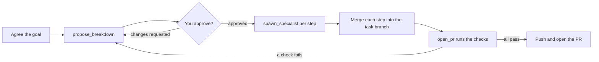

# Orchestrated tasks

An orchestrated task is run by an orchestrator agent instead of one agent you fly by hand. The orchestrator
agrees the goal with you, proposes a breakdown you approve in the side panel, launches specialist agents, merges
their branches and opens one PR after the repo's tests pass. The board shows the task as one group with a
rolled-up status.

## Types

Pick a Type when you create a task, instead of Solo. The built-in types are `direct` (one step) and `structured`
(brainstorm, plan, one specialist per task, a review step).

## Flow

<video src="../../assets/shots/orchestrated-direct.webm" poster="../../assets/shots/orchestrated-direct.png" autoplay loop muted playsinline
       aria-label="A direct orchestrator asks one question, its breakdown is approved, a pastry-chef specialist does the step, and the tests pass before the pull request opens"></video>

1. New task: pick the Type, the persona and one repo; the roster (the specialists it may use) comes from the
   repo.
2. You talk to the orchestrator in its terminal until the goal is agreed.
3. It proposes a breakdown; the task goes to Needs you. Approve it or request changes in the side panel.
4. It launches one specialist per step. Each is a normal agent on the board with its own worktree, on a sub-branch
   of the task branch; the orchestrator merges each finished step back.
5. When the steps are done it calls `open_pr`: the daemon runs the checks the repo's workflow file lists for the
   change, and only if they pass pushes the task branch and opens the PR. The default stop is an open PR; nothing
   is merged.

Every question and permission prompt still reaches you; there is no autopilot yet. Orchestrators and specialists
cannot spawn in-chat subagents, and an orchestrated task has exactly one repo.

## The workflow file

A repo needs a **`.fleet/workflow.yml`** on its base branch on `origin` before an orchestrated task can use it: it
lists the checks the gate runs before a pull request, and is fetched when the task is created.

## Limits

Three limits stop a task that loops or grows without end.

| Limit | Default | What it caps |
| --- | --- | --- |
| `max_breakdown_versions` | 8 | The breakdown versions one task may accumulate |
| `max_steps` | 20 | The steps one breakdown may declare |
| `max_parallel_specialists` | 3 | The specialists one orchestrator may have running at once |

When a limit is hit, the daemon refuses the call and tells the orchestrator why:

- **`max_breakdown_versions`**: the task already has that many breakdowns, so a new one is refused. The
  orchestrator stops and asks you.
- **`max_steps`**: the proposed breakdown has more steps than the limit. Every proposal restates the carried
  steps, so its length is the task's whole step count. The orchestrator stops and asks you.
- **`max_parallel_specialists`**: that many specialists are running. This is not a failure. The orchestrator waits
  for one to finish, then starts the next step.

For the first two, a `limit reached` refusal is a hard stop: the orchestrator stops and tells you, and you either
raise the limit in Management → Products (see [Overrides](management.md#overrides)) or end the task. Versions and
steps count over the whole task; the parallel cap counts only the specialists running now.

The refusal names the limit, its value and where the value came from.

Set the global limits in **Settings**, on the General tab, under **Limits**. Save writes them to `config.toml` and
restarts the daemon; running agents keep going. A product can override each limit: see
[Overrides](management.md#overrides). The key names are also in the
[configuration reference](../reference/configuration.md).

## Push blocking

Pushes and PRs by the agents themselves are blocked on a best-effort basis, not as a security boundary: text deny
rules on `git push`, `gh pr create` and `gh api`, plus an env block that points `origin`'s push URL nowhere. They
stop the model's ordinary attempts. Known bypasses: `git push <url>` hidden from the text rules (in `bash -c` or a
script), `env -u GIT_CONFIG_COUNT git push`, and a repo whose own config sets `remote.origin.pushurl`. `open_pr` is
the only push the daemon makes, and only after the tests pass.

## Definitions

Definitions live in the binary (built-ins, read-only) plus your files in `~/.config/fleet-manager/fleet/`
(`orchestrators/`, `specialists/`, `skills/`); a user file with a built-in's name overrides it. Edit them in
Management: see [Management](management.md). A definition can set a `model:`; see
[Models](management.md#models).
