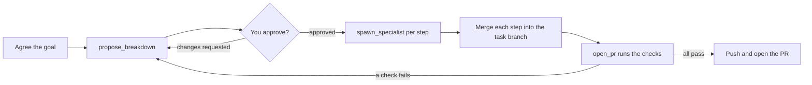

# Orchestrated tasks

An orchestrated task is run by an orchestrator agent instead of one agent you fly by hand. The orchestrator
agrees the goal with you, proposes a breakdown you approve in the side panel, launches specialist agents, merges
their branches and opens one PR after the repo's tests pass. The board shows the task as one group with a
rolled-up status.

## Types

Pick a Type when you create a task, instead of Solo. The built-in types are `direct` (one step) and `structured`
(brainstorm, plan, one specialist per task, a review step).

## Flow

1. New task: pick the Type, the persona and one repo. The orchestrator may use every specialist that loads, less
   the ones the product hides (see [Specialists](#specialists)).
2. You talk to the orchestrator in its terminal until the goal is agreed.
3. It proposes a breakdown; the task goes to Needs you. Approve it or request changes in the side panel.
4. It launches one specialist per step. Each is a normal agent on the board with its own worktree, on a sub-branch
   of the task branch; the orchestrator merges each finished step back.
5. When the steps are done it calls `open_pr`: the daemon runs the checks the repo's workflow file lists for the
   change, and only if they pass pushes the task branch and opens the PR. The default stop is an open PR; nothing
   is merged.

Every question and permission prompt still reaches you; there is no autopilot yet. Orchestrators and specialists
cannot spawn in-chat subagents, and an orchestrated task has exactly one repo.

## Specialists

An orchestrator is shown every specialist that loads, built-in or yours, with its summary, and picks one per step.
A new specialist you add in Management is offered to the next orchestrated task with nothing else to set.

To keep one away from a product, tick it under **Hidden specialists** in Management → Products → the product and
**Save hidden specialists**. A hidden specialist is left out of the orchestrator's `CLAUDE.md`, and a breakdown step
that names it is refused: `step <n>: <name> is not one of this task's specialists`. A task keeps the specialists it
started with: hiding or unhiding one changes only the tasks started after. With every specialist hidden, a new
orchestrated task is refused: `every specialist is hidden or does not load: unhide one in Management → Products`.

The daemon serves the list as `hidden_specialists` on each product, and replaces it with
`PUT /api/products/{id}/hidden-specialists` (`{"hidden": ["<name>", …]}`); a name that is not a specialist that loads
is refused with 400.

## The workflow file

A repo needs a **`.fleet/workflow.yml`** on its base branch on `origin` before an orchestrated task can use it: it
lists the checks the gate runs before a pull request, and is fetched when the task is created.

## Internal resources

Each product has a private notes repo. Designs, plans and decisions go there instead of into the code repo. It is
either local-only or your own remote repo.

- **Local-only** (the default): a git repo the app owns at `<state_dir>/internal/<product-id>`, with no remote.
  Nothing pushes it. It is made with the product, or on the first orchestrated task of an older product.
- **Your own repo:** set an HTTPS **Internal repo URL** on the product (Management → Products). The daemon clones it
  to the same folder, `<state_dir>/internal/<product-id>`, using the product's default persona's GitHub login, so the
  URL must be on that persona's host and the product needs a default persona. The clone is the app's own: it is never
  your checkout, and nothing you have checked out is touched. Tasks start from the remote's `main`, and each task's
  notes are merged into `main` and pushed. An existing local-only repo is moved aside, not merged, to
  `<product-id>.local-<YYYYMMDD-HHMMSS>` next to it.

Either way a new repo has the same layout: a `README.md` and, in `specs/`, `plans/`, `tasks/`, `docs/` and
`scripts/`, a `README.md` saying what goes there. An empty remote is given the layout and it is pushed; a remote
that has branches but no `main` is refused.

- **Orchestrator:** gets a read-write worktree at `<task workdir>/internal`, on the branch `task/<task-name>`. Its
  `CLAUDE.md` has an "Internal resources" section naming the path and the task's folder in it, `tasks/<task-name>/`.
  The `structured` orchestrator writes `tasks/<task-name>/design.md` and `tasks/<task-name>/plan.md` there and
  commits them with `git -C <path> add -A && git -C <path> commit -m "<message>"`. Solo tasks get no internal
  worktree.
- **Specialists:** get a read-only, detached snapshot at `<task workdir>/internal-snapshots/<n>-<slug>`, as of the
  orchestrator's last commit when the specialist was spawned. Their briefs name the design and plan by their paths
  relative to the notes folder, such as `tasks/<task-name>/plan.md`. `spawn_specialist` is refused while the
  orchestrator's internal worktree has uncommitted changes: `commit your internal resources first: git -C <path>
  add -A && git -C <path> commit -m "<message>"`.
- **Merging:** each successful `open_pr` merges `task/<task-name>` into the product's `main` notes. On a product
  with its own repo the daemon first brings `main` up to the remote's, then pushes it, trying again up to three times
  when the remote moved meanwhile. The PR is already open, so a failed merge or push never stops it. The task log
  says what happened:

    | Log line | What happened | What to do |
    | --- | --- | --- |
    | `internal notes merged and pushed` | Merged and pushed to your repo. | Nothing. |
    | `internal notes merged into the product's notes` | Merged, on a product with no remote to push to. | Nothing. |
    | `internal notes merged, not pushed: <message>; the next merge or a daemon restart retries` | Merged locally; the push failed, for example the remote was unreachable or the default persona's GitHub login failed. | Nothing, or fix the cause named in the message. |
    | `internal notes not merged: conflict in <paths>; task/<task-name> is pushed to resolve by hand` | The task's notes conflict with `main`. The merge was aborted and the branch pushed. | Merge `task/<task-name>` into `main` from your own checkout of the repo, resolve, and push. |
    | `internal notes not merged: <git's message>; task/<task-name> is pushed to resolve by hand` | The merge stopped for another reason; same as above. | Same. |
    | `internal notes not merged: conflict in <paths>; the next pull request retries` | The same conflict on a product without a remote, or with the remote unreachable: nothing was pushed. | Nothing. The branch stays and the next PR merges it again. |
    | `internal notes not merged: <git's message>; the next pull request retries` | The same, for a stop that is not a conflict. | Same. |

    Any line can end with `; earlier unpushed notes conflicted with the remote and are on fleet/unpushed-<stamp> to
    merge by hand`. Notes merged earlier but never pushed conflicted with new commits on the remote. The daemon
    pushed them to that branch and restarted its `main` from the remote's. Merge `fleet/unpushed-<stamp>` into
    `main` from your own checkout, resolve, and push.

    A task that starts while the remote cannot be fetched logs `internal notes: cannot fetch the remote (<message>);
    starting from the local copy`, or `internal notes: cannot reach the remote (<message>); starting from the local
    copy` when the default persona's GitHub login fails. Its branch is cut from the app's last copy of `main`, and the
    merge reconciles it later. When the daemon starts it also pushes any notes an earlier push left behind, in the
    background. A conflict found then is logged by the daemon, not on a task, and shows in Internal resources as
    below.
- **Archive:** removes the worktrees and keeps the `task/<task-name>` branch.

The read-only access is not a security boundary, like the push block below. A specialist gets an
`Edit(//<path>/**)` deny rule, which covers the built-in file-editing tools, plus the snapshot as an additional
directory. It runs as the same OS user, so a shell command can still write there.

Read them in Management → Products → a product → **Internal resources**: a branch picker, the files and, for a
file, its text and last commit. It is read-only. Above them it says `Remote: <url>` (credentials removed) or
`Local only`, how many commits are `not pushed`, `Unpushed notes parked on fleet/unpushed-<stamp>; merge it by hand`
for each parked branch still on the remote and, after a failed push, the error. The daemon serves the same data over
HTTP:

| Route | Returns |
| --- | --- |
| `GET /api/products/{id}/internal/branches` | The branches |
| `GET /api/products/{id}/internal/files?branch=` | The files on a branch |
| `GET /api/products/{id}/internal/file?branch=&path=` | One text file |
| `GET /api/products/{id}/internal/history?branch=&path=&limit=` | Commits, newest first |

`branch` defaults to `main`; `limit` defaults to 50 and is at most 200. Files are text up to 1 MiB. A `..`
component, an absolute path or a symlink is refused with 400; an unknown product, branch or path is 404.

## Limits

Three limits stop a task that loops or grows without end.

| Limit | Default | What it caps |
| --- | --- | --- |
| `max_breakdown_versions` | 8 | The breakdown versions one task may accumulate |
| `max_steps` | 20 | The steps one breakdown may declare |
| `max_parallel_specialists` | 3 | The specialists one orchestrator may have running at once |

When a limit is hit, the daemon refuses the call and tells the orchestrator why:

- **`max_breakdown_versions`**: the task already has that many breakdowns, so a new one is refused. The
  orchestrator stops and asks you.
- **`max_steps`**: the proposed breakdown has more steps than the limit. Every proposal restates the carried
  steps, so its length is the task's whole step count. The orchestrator stops and asks you.
- **`max_parallel_specialists`**: that many specialists are running. This is not a failure. The orchestrator waits
  for one to finish, then starts the next step.

For the first two, a `limit reached` refusal is a hard stop: the orchestrator stops and tells you, and you either
raise the limit in Management → Products (see [Overrides](management.md#overrides)) or end the task. Versions and
steps count over the whole task; the parallel cap counts only the specialists running now.

The refusal names the limit, its value and where the value came from.

Set the global limits in **Settings**, on the General tab, under **Limits**. Save writes them to `config.toml` and
restarts the daemon; running agents keep going. A product can override each limit: see
[Overrides](management.md#overrides). The key names are also in the
[configuration reference](../reference/configuration.md).

## Push blocking

Pushes and PRs by the agents themselves are blocked on a best-effort basis, not as a security boundary: text deny
rules on `git push`, `gh pr create` and `gh api`, plus an env block that rewrites every push to the persona's host
(`https://<host>/`, `ssh://git@<host>/`, `git@<host>:`) and to the task repo's own `origin` URL to a transport that
does not exist. They stop the model's ordinary attempts, a `git push <url>` included. The block goes by URL, not by
remote name, so the throwaway remotes a repo's own tests create (local paths, often named `origin`) push as they do
on CI. Known bypasses: `env -u GIT_CONFIG_COUNT git push`, and a remote with its own `pushurl` in its config (git
then ignores the rewrite). `open_pr` is the only push the daemon makes, and only after the tests pass.

The checks `open_pr` runs see the same block, so a test script that pushes fails like an agent would, but not the
persona's commit identity (`GIT_AUTHOR_*`, `GIT_COMMITTER_*`) or its protocol limit (`GIT_ALLOW_PROTOCOL`): the
repo's tests run as they do on CI.

## Definitions

Definitions live in the binary (built-ins, read-only) plus your files in `fleet/` in the
[config folder](../getting-started/install.md#where-your-data-lives)
(`orchestrators/`, `specialists/`, `skills/`); a user file with a built-in's name overrides it and keeps
its own text: it has no internal-resources wording unless you add it. Edit them in
Management: see [Management](management.md). A definition can set a `model:`; see
[Models](management.md#models).
