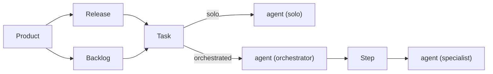

# Products and releases

A product is something long-running that holds repos, releases and tasks. A release is a version of a product,
with a start and a target date. A task belongs to one product and to at most one release; a task in no release is
in the backlog. An orchestrated task is split into steps, each run by its own agent.

## Products

Management → Products is where products are set up: a name, its repos, and each repo's specialist roster (the
specialists an orchestrated task on that repo may use). **+ New product** there, or **New product** in the drawer,
creates one.

The drawer's product switcher picks the active product. The board, New task and the Releases view act on it.

## Releases

<video src="../../assets/shots/releases.webm" poster="../../assets/shots/releases.png" autoplay loop muted playsinline
       aria-label="Two running tasks moved into a new Spring menu release, then the board filtered to that release"></video>

The Releases view lists the active product's releases, open ones first. Each release shows two bars side by side:

- **Tasks**: tasks merged out of tasks in the release.
- **Days**: days used out of days in the span, from the start date to the target date. An open release past its
  target shows how many days it is overdue instead.

A task counts as merged when every repo it changed has a merged pull request and none is still open. A task whose
repos have no URL has no pull request to wait for: **Mark done** on it in the Tasks view counts it instead. An
archived task that was never merged is dropped from the count.

### Create a release

1. Open Releases in the drawer.
2. Click **New release**.
3. Fill in **Version**, **Start** and **Target**. Dates are `YYYY-MM-DD`; Start defaults to today.
4. Click **Create**.

Each release has **Edit**, **Delete** and **Mark released**. Delete asks to confirm, and the release's tasks go to
the backlog. Mark released stamps today's date; **Unrelease** reopens it.

### Put tasks in a release

- New task has a **Release** field: one of the product's open releases, or Backlog (the default).
- In the Releases view, **Move to…** under a task moves it to another open release or to the backlog. A merged
  task, or one marked done, stays in its release.

### Filter by release

The board and the Tasks view each have a **Release** filter: All releases, one of the open releases, or Backlog.
A released or deleted release is no longer offered, and a filter on one falls back to All releases.
