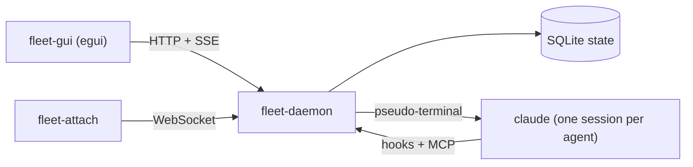

# Architecture

How the daemon, the desktop app and the agents fit together, and what each crate does.

- `fleet-daemon` runs each agent in a pseudo-terminal it owns, hands it hooks that post status back, and serves an
  MCP endpoint for repo requests and, for orchestrated tasks, the breakdown, spawn and `open_pr` tools. It listens
  on `127.0.0.1:7878` and keeps state in the data folder (see [Configuration](configuration.md)). Each product's
  private notes repo is `internal/<product-id>` there; see
  [Internal resources](../guide/orchestrated-tasks.md#internal-resources).
- The daemon is the only source of truth about the machine: which tools are installed, their versions and the
  `PATH` they were found on (`/api/tools`), and its own version (`/api/version`). The app asks it rather than
  looking for itself, so the daemon and its clients can be deployed separately.
- `fleet-gui` is the desktop app. It starts the daemon if none is running, shows a progress screen while it asks
  the daemon for the tool check, and draws the board from a UI schema the daemon serves, so columns, fields and
  actions are defined in one place (`crates/fleet-api/src/ui.rs`). It also checks GitHub for a newer release.
- `fleet-attach` takes over one agent's terminal from a terminal window; the app's **Open in terminal** runs it.
- The web UI in `web/` is embedded in the daemon. It is frozen at its v1 state until it comes back for remote access.
  It knows nothing of personas, and a task now needs one, so it cannot start tasks; use the desktop app.

## Agents run in built-in terminals

Agents always run as the interactive `claude` CLI, each in a pseudo-terminal the daemon owns (ConPTY on Windows).
The daemon keeps a screen of each one for the app's live view and fans its output out to attached terminals. A
session's whole process tree goes with it when it stops: a process group on Linux, a Job object on Windows. When the
daemon stops, running agents stop too, and the next start resumes them with `claude --resume`.

This replaced tmux, which has no Windows build. Headless mode (`claude -p` with stream-json) was considered and
rejected: the real terminal stays, and `fleet-attach` is the way to take over.

## Crates

| Crate | Job |
|---|---|
| `fleet-api` | The client/daemon contract: types only, exported to TypeScript for the web UI |
| `fleet-daemon` | Agents and their terminals, the tool check, hooks, MCP, git worktrees, SQLite store, HTTP API |
| `fleet-client` | Everything a Rust front end needs: config, HTTP, event stream, starting and stopping the daemon, attach, installs, shortcuts, the update check; also builds `fleet-attach` |
| `fleet-gui` | The egui desktop app |
| `fleet-fs` | Per-OS folders, child-process setup, and the filesystem and git queries behind the folder picker |
| `fleet-log` | Logging shared by the daemon and the app |
| `fleet-demo` | The scripted stand-in for `claude` and the director that record the demo media; see [Demo media](../contributing/demo.md) |
