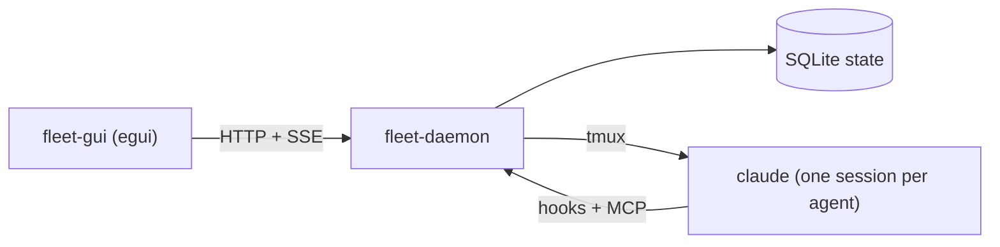

# Architecture

How the daemon, the desktop app and the agents fit together, and what each crate does.

- `fleet-daemon` spawns each agent in a dedicated tmux server, hands it hooks that post status back, and serves an
  MCP endpoint for repo requests and, for orchestrated tasks, the breakdown, spawn and `open_pr` tools. It
  listens on `127.0.0.1:7878` and keeps state in `~/.local/share/fleet-manager`.
- `fleet-gui` is the desktop app. It starts the daemon if none is running and draws the board from a UI schema the
  daemon serves, so columns, fields and actions are defined in one place (`crates/fleet-api/src/ui.rs`).
- The web UI in `web/` is embedded in the daemon. It is frozen at its v1 state until it comes back for remote access.
  It knows nothing of personas, and a task now needs one, so it cannot start tasks; use the desktop app.

## Agents run in tmux

Agents always run as the interactive `claude` CLI in tmux (Antonio, 2026-10-23). Headless mode (`claude -p` with
stream-json) was considered and rejected: tmux keeps the real terminal and `tmux attach` as the way to take over.

## Crates

| Crate | Job |
|---|---|
| `fleet-api` | The client/daemon contract: types only, exported to TypeScript for the web UI |
| `fleet-daemon` | Agents, tmux, hooks, MCP, git worktrees, SQLite store, HTTP API |
| `fleet-client` | Everything a Rust front end needs: config, HTTP, event stream, starting and stopping the daemon |
| `fleet-gui` | The egui desktop app |
| `fleet-fs` | Filesystem and git queries behind the folder picker |
| `fleet-log` | Logging shared by the daemon and the app |
| `fleet-demo` | The scripted stand-in for `claude` and the director that record the demo media; see [Demo media](../contributing/demo.md) |
